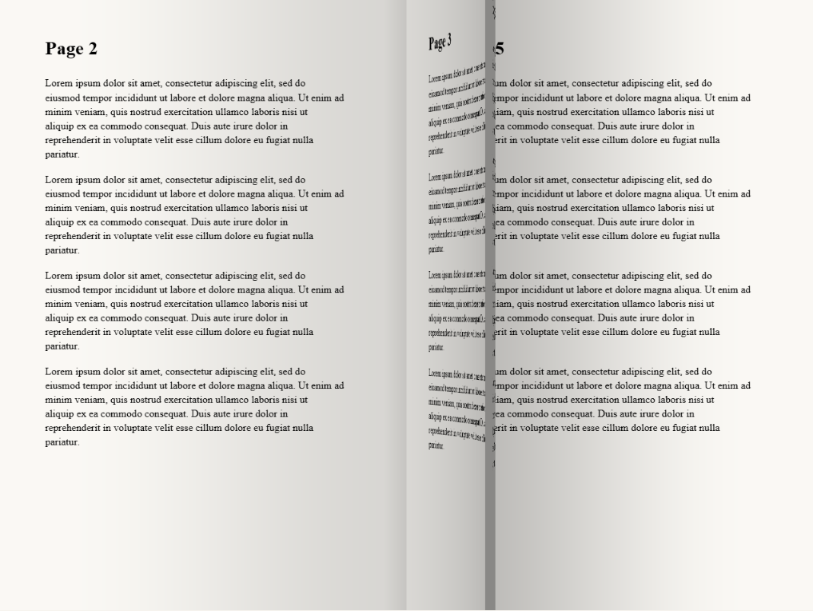

# PageTurn

**A Windows PDF reader that feels like a real book.** Open a PDF and you get only the book: a two-page spread on a calm background, a realistic WebGL page flip when you turn, and tools that stay hidden until you reach for them.



> Status: active development. Core reading, annotations, ink and the immersive reader are done. AI explanations and dictionary look-up are next.

---

## Features

### Reading
- **Two-page spreads** with page 1 as a cover on the right; single page in narrow windows (under 1000 px) or by choice.
- **WebGL page flip.** Press an arrow key, click or scroll and the whole page lifts at its edge and swings over the spine like a real leaf, with perspective, a slight paper bend, lighting and shadows on the pages beneath. Drag the page edge and it follows your hand. Falls back to a slide transition without WebGL.
- **Nothing but the book.** No toolbars, no sidebars. In a normal window the window itself takes the book's shape, so there is no empty space around the pages.
- **Themes:** Light (`#FAF8F4` paper), Sepia, and Dark. Dark inverts page brightness in the shader and keeps colours.
- Zoom 50–400% inside the book view (drag or scroll to pan), go to page, table of contents, whole-book search, and your last page remembered per book.
- Password-protected PDFs are supported; scanned PDFs open with a notice that their text can't be selected.

### Hidden toolbar
Move the pointer to the top edge, or press **T**, and a dark pill slides in:

Back · Highlighter · Underline (straight / wavy) · Pen · Eraser · Bookmark · Contents · Search · page `12 / 500` · Aa (theme, zoom, layout, settings) · Fullscreen

It hides again 800 ms after the pointer leaves. It stays pinned while a tool is active, until **Esc**. After 2 s without movement the cursor hides too.

### Annotations
- **Highlights** in four colours, underlines (straight or wavy), with selections spanning both pages split per page.
- **Right-click a selection** for: Make a note · Ask AI · Look up · Highlight · Copy.
- **Notes** on text show a dotted underline and a margin dot. Free sticky notes can go anywhere ("Add note here"). Notes autosave.
- **Pen and marker ink** with real stylus pressure (via `perfect-freehand`), 6 colours, 3 widths, an eraser, and undo/redo.
- **Bookmark tabs:** pastel, numbered ribbons sticking out of the right page edge. Click to jump; right-click to rename or delete.
- Annotations are **baked into the page texture**, so they curl with the paper.
- Everything is saved locally and survives restarts and moving the PDF: books are identified by a content hash, not a path.

### Keyboard

| Key | Action |
|---|---|
| `→` `Space` `PageDown` / `←` `Shift+Space` `PageUp` | Next / previous spread |
| `T` | Show / hide the toolbar |
| `H` · `N` · `A` | Highlight · note · Ask AI on the selection |
| `B` or `Ctrl+D` | Bookmark the page |
| `P` · `E` | Pen · eraser |
| `Ctrl+Z` / `Ctrl+Y` | Undo / redo ink |
| `Ctrl+F` · `Ctrl+G` | Search · go to page |
| `Ctrl` `+` / `-` / `0` | Zoom |
| `F11` | Fullscreen |
| `Esc` | Close card → leave tool → hide toolbar → exit fullscreen |

---

## Getting started

Requirements: **Windows 10/11**, **Node.js 22+**, npm 10+. Native modules need the Visual Studio Build Tools (C++ workload).

```bash
git clone https://github.com/GuninderSinghBhatia/pageturn.git
cd pageturn
npm install
npm run dev
```

> **VS Code terminal?** VS Code sets `ELECTRON_RUN_AS_NODE=1`, which makes Electron start as plain Node. Clear it first:
> PowerShell `$env:ELECTRON_RUN_AS_NODE=$null` · bash `unset ELECTRON_RUN_AS_NODE`

Then drag a PDF onto the window, or click **Open PDF**.

### Scripts

| Script | What it does |
|---|---|
| `npm run dev` | Run with hot reload |
| `npm run build` | Typecheck and build to `out/` |
| `npm run build:win` | Build a Windows installer (electron-builder) |
| `npm test` | Unit and component tests (Vitest) |
| `npm run test:e2e` | Build, then end-to-end tests against the real app (Playwright for Electron) |
| `npm run lint` · `npm run format` | ESLint · Prettier |
| `npm run fixtures` | Regenerate the test PDFs in `tests/fixtures/` |

---

## How it works

```
Main process (Node)                        Renderer (React)
───────────────────                        ────────────────
SQLite (better-sqlite3)                    ReaderView
  books · highlights · notes               ├─ BookStage (WebGL curl) / SlideStage
  ink_strokes · bookmarks · settings       ├─ PageOverlay per page: pdf.js text layer,
library import, hashing, thumbnails        │   annotation canvas, notes, bookmark tabs
window shape (aspect lock)                 ├─ ReaderToolbar (hidden pill)
          ▲                                ├─ SelectionMenu, cards, ink input
          │  typed IPC, zod-validated      pdf.js in a Web Worker + LRU page cache
          └──────────── window.api ───────▶ Zustand stores
```

- **Security:** `contextIsolation`, `sandbox` and no `nodeIntegration`. The renderer can reach only a typed `window.api` bridge, and every IPC payload is validated with **zod** in the main process. Strict CSP.
- **Page flip:** a 40×60 mesh rotated around the spine in the vertex shader; the paper bends along a length-preserving arc with perspective (`webgl/flipMath.ts`, unit-tested and mirrored in GLSL). Frame times hold at about 7 ms p95 on a 1000-page PDF; the perf test fails above 20 ms.
- **Annotations:** coordinates are normalized 0..1 of the page, so they survive zoom and layout changes. Saves are optimistic, with 3 retries and a rollback plus toast on failure. Ink points are stored as packed `Float32Array` blobs.
- **Data** lives in `%APPDATA%/PageTurn/` (`pageturn.db`, `thumbnails/`). Removing a book can keep its annotations, which come back if the same file is re-imported.

### Tech stack
Electron · electron-vite · TypeScript (strict) · React 18 · Zustand · CSS Modules · pdfjs-dist · WebGL2 · better-sqlite3 · zod · perfect-freehand · Vitest · Testing Library · Playwright · ESLint · Prettier

### Project layout
```
src/main/        app bootstrap, IPC handlers, SQLite + migrations, library import
src/preload/     the typed window.api bridge
src/shared/      types and IPC contract (channels + zod schemas)
src/renderer/
  library/       library grid, import, thumbnails
  reader/        ReaderView, layout math, keyboard
    BookStage/   WebGL page-flip renderer, gestures, zoom/pan, turn controller, slide fallback
    annotations/ overlays, selection, highlights, notes, bookmark tabs
    chrome/      hidden toolbar, display menu, idle handling
    ink/         pen input, strokes, undo history
    pdf/         pdf.js service, page cache, text layer
  settings/      settings screen
  stores/        Zustand stores
tests/unit/      Vitest (main, shared, renderer)
tests/e2e/       Playwright for Electron, incl. screenshot and frame-time tests
docs/superpowers/ design specs and implementation plans
```

---

## Testing
- **170 unit and component tests**: page-flip geometry, zoom/pan maths, layout, turn controller, repositories against in-memory SQLite, IPC validation, stores, drawing, ink history, toolbar reveal logic.
- **31 end-to-end tests** drive the built app: import, reading, curl gestures, highlights across pages, notes, bookmarks, ink, restarts, password PDFs, the WebGL fallback, plus a screenshot test of the page flip and a frame-time test on a 1000-page PDF.

---

## Roadmap
- [x] Library, reader, WebGL page flip
- [x] Highlights, notes, bookmarks, pen ink with undo
- [x] Immersive reader (hidden toolbar, selection menu, bookmark tabs, themes)
- [ ] **Look up** (dictionary / Wikipedia) and **Ask AI** (streamed explanations with your own API key)
- [ ] Notebook panel and Markdown export, automatic backups
- [ ] Installer, file association, auto-update, code signing

Design docs: [`docs/superpowers/specs/`](docs/superpowers/specs/) · implementation plans: [`docs/superpowers/plans/`](docs/superpowers/plans/) · progress log: [`docs/PROGRESS.md`](docs/PROGRESS.md)

## Branches
- `main`: library, reader and page curl (Plan 1).
- `plan2-annotations`: adds highlights, notes, bookmarks and ink.
- `reader-redesign`: the immersive reader, built on `plan2-annotations`. **This is the latest work**, pending merge into `main`.

## License
No license has been chosen yet; all rights reserved by the author.
