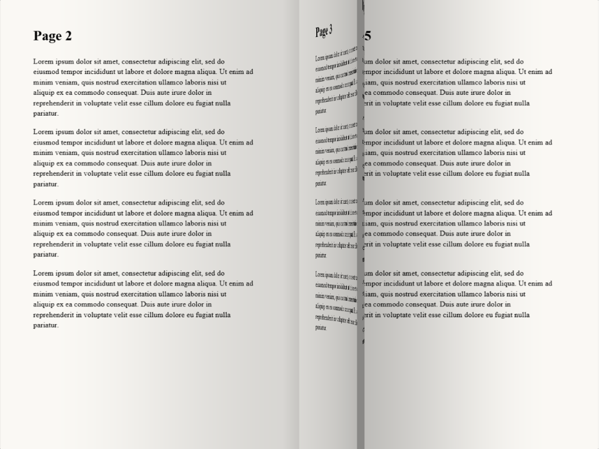

# PageTurn

**A Windows PDF reader that feels like a real book.** Open a PDF and you get only the book: a two-page spread on a calm background, a realistic WebGL page flip when you turn, and tools that stay hidden until you reach for them.

**It is also a RAG application.** *Ask the book* answers questions from your PDF with **vector RAG plus Self-RAG checks**, all inside the app: it searches the book on your computer, keeps only passages that answer the question, checks the answer against them, cites every page, and won't spoil pages you haven't read yet. On a hand-checked golden set it finds the right page in the top 3 passages **84%** of the time (80% without the checks) and answers **96%** of questions instead of "I don't know" (88% without) ([numbers below](#ask-the-book-vector-rag--self-rag)).



## Download

**[⬇ Download PageTurn for Windows](https://github.com/GuninderSinghBhatia/pageturn/releases/latest/download/PageTurn-Setup.exe)** — Windows 10/11, 64-bit, about 163 MB (most of it is the two models Ask runs on your computer). Always the newest version.

Run it and choose where to install. The installer is not code-signed yet, so Windows may show "Windows protected your PC": click **More info → Run anyway**. Afterwards, right-click any PDF and choose **Open with → PageTurn**.

PageTurn updates itself: when a new version is out, it downloads in the background and a message offers **Restart now**.

To publish an update (maintainers): see [docs/UPDATER.md](docs/UPDATER.md).

---

## Features

### Reading

- **Two-page spreads** with page 1 as a cover on the right; single page in narrow windows (under 1000 px) or by choice.
- **WebGL page flip.** Press an arrow key, click or scroll and the whole page lifts at its edge and swings over the spine like a real leaf, with perspective, a slight paper bend, lighting and shadows on the pages beneath. Drag the page edge and it follows your hand. Falls back to a slide transition without WebGL.
- **Nothing but the book.** No toolbars, no sidebars. In a normal window the window itself takes the book's shape, so there is no empty space around the pages.
- **Themes:** Light (`#FAF8F4` paper), Sepia, and Dark. Dark inverts page brightness in the shader and keeps colours.
- Zoom 50–400% inside the book view (drag or scroll to pan), go to page, table of contents, whole-book search, and your last page remembered per book.
- Password-protected PDFs are supported; scanned PDFs open with a notice that their text can't be selected.

### Hidden toolbar

Move the pointer to the top edge, or press **T**, and a dark pill slides in:

Back · Highlighter · Underline (straight / wavy) · Pen · Eraser · Bookmark · Contents · Search · page `12 / 500` · Aa (theme, zoom, layout, settings) · Fullscreen

It hides again 800 ms after the pointer leaves. It stays pinned while a tool is active, until **Esc**. After 2 s without movement the cursor hides too.

### Annotations

- **Highlights** in four colours, underlines (straight or wavy), with selections spanning both pages split per page.
- **Right-click a selection** for: Make a note · Ask AI · Look up · Highlight · Copy.
- **Look up** a selection on Wikipedia: a summary card with the article image appears beside the page. In Settings you can switch to Wiktionary, Merriam-Webster, Britannica, Google, DuckDuckGo or any site (`https://…{query}`), pick the Wikipedia language, and open full pages in a small in-app window or your browser.
- **Notes** on text show a dotted underline and a margin dot. Free sticky notes can go anywhere ("Add note here"). Notes autosave.
- **Pen and marker ink** with real stylus pressure (via `perfect-freehand`), 6 colours, 3 widths, an eraser, and undo/redo.
- **Bookmark tabs:** pastel, numbered ribbons sticking out of the right page edge. Click to jump; right-click to rename or delete.
- Annotations are **baked into the page texture**, so they curl with the paper.
- Everything is saved locally and survives restarts and moving the PDF: books are identified by a content hash, not a path.

### Ask the book (RAG)

- **Ask the book:** ask a question and get an answer built only from passages found in your PDF, with clickable page citations.
- **Who is this?:** select a name or term and get a summary of every mention so far.
- **Spoiler Shield:** passages past the page you are on are never used.
- Built into the app: every PDF you add is indexed in the background on your computer, with the two small models that ship in the installer's `models` folder. Answers are written by the AI you pick in Settings (your Claude or ChatGPT plan, or an API key).

### Help, notebook and your data

- **Help panel (Ctrl+E):** select a passage and get a streamed explanation from your own Anthropic, OpenAI or Gemini key (stored encrypted on your computer), with follow-ups, quick actions and Save as note. The **Web** tab searches the passage in-app.
- **Notebook (Ctrl+B):** every highlight, note, bookmark and handwritten page in a book, searchable and filterable, with Markdown export.
- **Backups:** a JSON backup every day (last 7 kept), plus manual export and import in Settings. Backups never include API keys.
- First-run tour with a Welcome book, an optional page-turn sound, auto-update, and logs in your user data folder. No usage data is collected.

### Keyboard

| Key                                                 | Action                                                   |
| --------------------------------------------------- | -------------------------------------------------------- |
| `→` `Space` `PageDown` / `←` `Shift+Space` `PageUp` | Next / previous spread                                   |
| `T`                                                 | Show / hide the toolbar                                  |
| `H` · `N` · `A`                                     | Highlight · note · Ask AI on the selection               |
| `B` or `Ctrl+D`                                     | Bookmark the page                                        |
| `P` · `E`                                           | Pen · eraser                                             |
| `Ctrl+Z` / `Ctrl+Y`                                 | Undo / redo ink                                          |
| `Ctrl+F` · `Ctrl+G`                                 | Search · go to page                                      |
| `Ctrl` `+` / `-` / `0`                              | Zoom                                                     |
| `F11`                                               | Fullscreen                                               |
| `Esc`                                               | Close card → leave tool → hide toolbar → exit fullscreen |

---

## Getting started

Requirements: **Windows 10/11** (WebView2 is built in), **Node.js 22+**, npm 10+, and **Rust** (stable, via [rustup](https://rustup.rs)) with the Visual Studio Build Tools (C++ workload).

```bash
git clone https://github.com/GuninderSinghBhatia/pageturn.git
cd pageturn
npm install
npm run dev
```

Then drag a PDF onto the window, or click **Open PDF**.

### Scripts

| Script                            | What it does                                                                                           |
| --------------------------------- | ------------------------------------------------------------------------------------------------------ |
| `npm run dev`                     | Run the app (Tauri) with hot reload for the UI                                                         |
| `npm run build`                   | Typecheck, then build the release app and its NSIS installer (`src-tauri/target/release/bundle/nsis/`) |
| `npm test`                        | Unit and component tests (Vitest)                                                                      |
| `npm run test:rust`               | Rust unit tests (`cargo test` in `src-tauri/`)                                                         |
| `npm run test:e2e`                | Build the debug app, then end-to-end tests against it (Playwright attached over CDP)                   |
| `npm run tauri:test`              | Tests of the Rust commands through the real app (`tests/tauri/`)                                       |
| `npm run release`                 | Build the signed installer and update feed in `dist-tauri/` (uploads nothing)                          |
| `npm run lint` · `npm run format` | ESLint · Prettier                                                                                      |
| `npm run fixtures`                | Regenerate the test PDFs in `tests/fixtures/`                                                          |

---

## How it works

```
Rust backend (src-tauri)                   Renderer (React, in WebView2)
────────────────────────                   ─────────────────────────────
SQLite (rusqlite)                          ReaderView
  books · highlights · notes               ├─ BookStage (WebGL curl) / SlideStage
  ink_strokes · bookmarks · settings       ├─ PageOverlay per page: pdf.js text layer,
library import, hashing, thumbnails        │   annotation canvas, notes, bookmark tabs
window shape (aspect lock)                 ├─ ReaderToolbar (hidden pill)
          ▲                                ├─ SelectionMenu, cards, ink input
          │  Tauri commands, validated     pdf.js in a Web Worker + LRU page cache
          └──────────── window.api ───────▶ Zustand stores
```

- **Security:** the renderer has no file, database or network access. It reaches the computer only through a typed `window.api` (`src/renderer/platform/tauriApi.ts`), whose calls are Rust commands that validate every argument. API keys are encrypted with Windows DPAPI. Strict CSP, and no global Tauri object in the page.
- **Page flip:** a 40×60 mesh rotated around the spine in the vertex shader; the paper bends along a length-preserving arc with perspective (`webgl/flipMath.ts`, unit-tested and mirrored in GLSL). Frame times hold at about 7 ms p95 on a 1000-page PDF; the perf test fails above 20 ms.
- **Annotations:** coordinates are normalized 0..1 of the page, so they survive zoom and layout changes. Saves are optimistic, with 3 retries and a rollback plus toast on failure. Ink points are stored as packed `Float32Array` blobs.
- **Data** lives in `%APPDATA%/PageTurn/` (`pageturn.db`, `thumbnails/`). Removing a book can keep its annotations, which come back if the same file is re-imported.

### Ask the book: vector RAG + Self-RAG

```
PDF ─▶ text per page ─▶ chunks (500 chars, 100 overlap, page kept) ─▶ all-MiniLM-L6-v2 ─▶ SQLite   (on your computer)
question ─▶ vector search (none past your page) ─▶ grade: cross-encoder keeps passages that answer it
         ─▶ none kept? rewrite the question once and search again, else "I don't know"
         ─▶ answer from the kept passages with page citations ─▶ ground: claims no passage backs? rewrite once
```

1. **Vector search** finds the passages whose meaning is closest to the question, in milliseconds, on your computer.
2. **Self-RAG checks** ([paper](https://arxiv.org/abs/2310.11511)), done the practical way with small judges instead of a trained model: a cross-encoder (ms-marco-MiniLM-L6-v2) **grades** each passage against the question; if none pass, the question is **rewritten** and searched once more; after answering, a **ground** check looks for claims no passage backs and has the answer rewritten without them. Every loop runs at most once, and every search keeps the Spoiler Shield page limit.
3. Only the kept passages go to the model, which answers from them and cites pages.

**Results on the golden set** (25 questions whose page numbers were checked against the PDF, 8 off-topic questions, 5 chat messages):

| Measure | Plain RAG | Self-RAG |
| --- | --- | --- |
| Right page in the top 3 passages (hit@3) | 80% | **84%** |
| Answered instead of "I don't know" | 88% | **96%** |
| Answers with every claim backed by a passage | 86% | 83–92% (two runs) |
| Chat messages ("thanks!") answered without searching | 0 of 5 | **5 of 5** |
| Off-topic questions refused | 8 of 8 | 8 of 8 |
| Spoiler leaks (cited a page past the reader) | 0 | 0 |
| Time / tokens per question | 1.2 s / 661 | 2.0 s / ~1,170 |

- Backed claims are judged by a different model (Qwen) from the one that answers, so no model grades its own work. No clear gain there yet.
- The question rewrite fired once in 25 questions and didn't find the page that time; Ask said "I don't know" instead of guessing.
- Scored with the Python version (`rag-service/`: FastAPI, LangGraph, Chroma, gpt-oss on Groq). The app runs the same pipeline in Rust and finds the same pages: 21 of 25 with grading in both ([parity test](src-tauri/src/rag/parity.rs)).
- Test book: a 991-page technical book (2,990 chunks). The sets are small, so one question moves a score by 4 points.

Details: [rag-service/SELF_RAG.md](rag-service/SELF_RAG.md) · raw results in `rag-service/evals/selfrag_results.csv`. Earlier retrieval experiments (a table-of-contents tree retriever and a Neo4j graph) are in `rag-service/` too; plain vectors beat them on cost.

### Tech stack

Tauri 2 (Rust, WebView2) · rusqlite · reqwest · TypeScript (strict) · React 18 · Vite · Zustand · CSS Modules · pdfjs-dist · WebGL2 · zod · perfect-freehand · Vitest · Testing Library · Playwright · ESLint · Prettier

Ask in the app: candle (all-MiniLM-L6-v2 and ms-marco-MiniLM-L6-v2 on the CPU) · pdf-extract (patched, `src-tauri/vendor/`)

RAG service (where the pipeline is designed and measured): Python · FastAPI · LangChain · LangGraph · Chroma · sentence-transformers · Groq (gpt-oss-120b / gpt-oss-20b) · pytest

### Project layout

```
src-tauri/       Rust backend: commands (library, annotations, settings, AI, look-up, rag,
                 web, export, window, app), SQLite + migrations, updater, installer config
  src/rag/       Ask the book in the app: PDF text, chunks, models, vector store, Self-RAG
  vendor/        pdf-extract with a fix (see its Cargo.toml note)
resources/       files the installer ships: sample book, models/ (fetched by scripts/fetch-models.mjs)
src/shared/      types and the window.api contract
src/renderer/
  platform/      window.api on top of the Rust commands
  library/       library grid, import, thumbnails
  reader/        ReaderView, layout math, keyboard
    BookStage/   WebGL page-flip renderer, gestures, zoom/pan, turn controller, slide fallback
    annotations/ overlays, selection, highlights, notes, bookmark tabs
    chrome/      hidden toolbar, display menu, idle handling
    ink/         pen input, strokes, undo history
    pdf/         pdf.js service, page cache, text layer
  settings/      settings screen
  stores/        Zustand stores
tests/unit/      Vitest (shared, renderer)
tests/e2e/       Playwright attached to the Tauri app, incl. screenshot and frame-time tests
tests/tauri/     the Rust commands through the real app; installer/ and measure/ next to it
rag-service/     Python RAG service (FastAPI): Self-RAG, vector RAG (Chroma), evals, earlier experiments
site/            the website (Next.js), deployed to pageturn-wheat.vercel.app
scripts/         release tools; demo-video/ films the app and edits the site's video
docs/superpowers/ design specs
```

---

## Testing

- **205 unit and component tests** (Vitest): page-flip geometry, zoom/pan maths, layout, turn controller, stores, drawing, ink history, toolbar reveal logic.
- **97 Rust unit tests**: repositories against in-memory SQLite, import and hashing, backup, prompts, AI error mapping, argument validation.
- **30 Tauri tests** call every Rust command through the real app, including "Open with", restarts and file drops.
- **42 end-to-end tests** drive the real app: import, reading, curl gestures, highlights across pages, notes, bookmarks, ink, restarts, password PDFs, the WebGL fallback, plus a screenshot test of the page flip and a frame-time test on a 1000-page PDF.

---

Design docs: [`docs/superpowers/specs/`](docs/superpowers/specs/) · components: [`docs/COMPONENTS.md`](docs/COMPONENTS.md) · updates: [`docs/UPDATER.md`](docs/UPDATER.md) · RAG service: [`rag-service/`](rag-service/) · website: [`site/`](site/)
